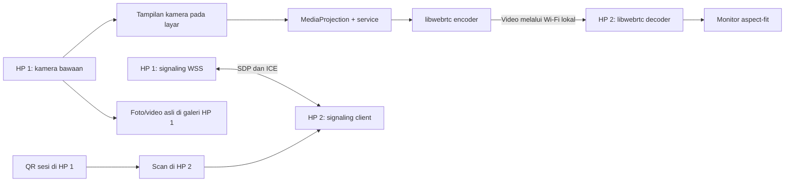

# Mirror Selfie — Tech stack dan blueprint

Tanggal: 17 Oktober 2026  
Status: v0.3; P1 selesai pada dua HP pengguna: streaming Wi-Fi/hotspot offline, foto, serta rekam/stop jarak jauh termasuk mode Film telah diuji. MVP lengkap dan benchmark lanjutan belum selesai.  
Progres pekerjaan: [PROGRESS.md](PROGRESS.md).

## 1. Tujuan produk

Menampilkan layar HP 1 di HP 2 agar pengguna dapat memastikan wajah dan tubuh masuk ke frame ketika memakai kamera belakang HP 1. Kedua HP berada berdekatan. Kebutuhan eksplisit mencakup pembuatan video di luar rumah tanpa router Wi-Fi. Prioritas: mudah tersambung, gambar cukup cepat untuk mengatur pose, dan dapat digunakan tanpa internet.

Rekomendasi awal: **aplikasi Android native Kotlin + MediaProjection + WebRTC melalui Wi-Fi lokal/hotspot**, dengan aplikasi yang sama dipasang di kedua HP.

Perangkat dan kebutuhan yang sudah diketahui, serta asumsi yang masih terbuka:

- HP 1 / perekam dan pengirim: **realme RMX3393, Android 14/API 34**, dipilih pengguna. HP 2 / monitor: **vivo V2131, Android 13/API 33**. Keduanya terkonfirmasi melalui ADB, melaporkan ABI `arm64-v8a, armeabi-v7a, armeabi`, dan berstatus `device` pada pemeriksaan terakhir. Deteksi USB belum membuktikan kompatibilitas streaming.
- Pengguna ingin tetap memakai kamera bawaan HP 1. Ini mempertahankan pilihan lensa, mode, dan pemrosesan foto yang biasa dipakai, sejauh aplikasi kamera mengizinkan tampilan ditangkap.
- HP 2 berfungsi sebagai monitor. Pengguna kemudian meminta dan memilih kontrol terbatas tombol rekam/stop dan foto, bukan kendali sentuh umum.
- Pemakaian pertama untuk dua HP pribadi; publikasi Play Store belum direncanakan.

## 2. Pilihan sumber gambar

| Pendekatan | Manfaat | Konsekuensi | Keputusan |
| --- | --- | --- | --- |
| Mencerminkan layar kamera bawaan | Pengguna tetap mengambil foto/video dengan kamera yang biasa dipakai | Perlu persetujuan berbagi layar; preview kamera harus diuji pada HP asli | Utama untuk MVP |
| Kamera di dalam aplikasi melalui CameraX | Preview dan shutter dapat dikendalikan oleh aplikasi sendiri | Kualitas/pemrosesan OEM belum tentu sama; perlu pipeline kamera dan penyimpanan foto | Alternatif jika pendekatan utama gagal atau pengguna memilihnya |

MediaProjection mengirim tampilan layar. Foto asli tetap dihasilkan kamera bawaan dan disimpan di HP 1; resolusi monitor bukan resolusi file foto. Hasil akhir foto juga bisa sedikit berbeda dari preview kamera karena pemrosesan kamera sendiri.

**Batas penting:** MediaProjection sendiri tidak memberikan kendali aplikasi kamera lain. Sesuai permintaan lanjutan pengguna, P1 menambahkan AccessibilityService opsional khusus `com.oplus.camera`, diaktifkan melalui pengaturan Android. Tombol shutter menggunakan aksi klik node kamera; perpindahan mode FOTO/VIDEO menggunakan tap terbatas pada carousel kamera realme dalam portrait. Kendali sentuh umum bukan bagian fitur ini. Foto serta rekam/stop sudah diuji, termasuk rekam/stop pada mode Film pilihan pengguna. Kalibrasi perpindahan mode belum dijamin pada model atau orientasi lain.

Jangan beralih diam-diam ke kamera internal jika preview kamera bawaan hitam. Catat hasil uji dan revisi pilihan sumber gambar bersama pengguna.

## 3. Metode koneksi

Penilaian berikut adalah keputusan desain untuk kebutuhan ini, bukan hasil benchmark.

| Metode | Kemudahan pemakaian | Pertimbangan | Prioritas |
| --- | --- | --- | --- |
| Kedua HP di Wi-Fi yang sama | Tinggi jika sudah tersambung | Tidak membutuhkan internet; router harus mengizinkan komunikasi antarklien | Jalur utama |
| HP 1 membuat hotspot, HP 2 bergabung | Cocok di luar rumah | Tidak membutuhkan router; perilaku hotspot/no-internet bergantung perangkat | Jalur kedua yang wajib diuji |
| Local-only hotspot dari aplikasi | Berpotensi mengurangi langkah manual | Perlu API, izin, dan pengujian OEM tambahan | Peningkatan setelah koneksi dasar terbukti |
| Wi-Fi Direct | Tidak membutuhkan router | Discovery/group-owner/reconnect menambah variasi implementasi | Ditunda |
| Bluetooth Classic/BLE | Berguna untuk kontrol kecil | Tidak dipilih sebagai transport video; Wi-Fi lebih sesuai untuk target stream ini | Di luar MVP |
| Internet + server relay | Bisa menjangkau lokasi berbeda | Menambah biaya, konfigurasi, serta ketergantungan koneksi luar | Di luar kebutuhan saat ini |
| USB antarkedua HP | Potensial untuk eksperimen khusus | Kabel, peran USB, dan dukungan perangkat mengurangi kemudahan | Ditunda |

Panduan koneksi MVP:

1. Jika sudah di jaringan Wi-Fi yang sama, langsung buat sesi dan scan QR.
2. Jika tidak ada router, nyalakan hotspot HP 1 melalui pengaturan Android, lalu sambungkan HP 2 sebelum pairing aplikasi.
3. Coba 5 GHz untuk jarak dekat jika kedua HP mendukung; sediakan 2,4 GHz sebagai alternatif. Jangan menjanjikan satu band selalu lebih baik.
4. Jika jaringan memakai client isolation, arahkan pengguna ke hotspot pribadi. Tidak ada fallback internet otomatis.

Local-only hotspot tersedia melalui API Android, sementara `WifiNetworkSpecifier` dapat meminta koneksi pada Android 10+ dengan dialog sistem. Keduanya menjadi calon otomasi, bukan janji koneksi diam-diam satu tap. [Hotspot lokal](https://developer.android.com/develop/connectivity/wifi/localonlyhotspot), [Network Request API](https://developer.android.com/develop/connectivity/wifi/wifi-bootstrap).

## 4. Tech stack yang direkomendasikan

| Lapisan | Pilihan | Peran / alasan |
| --- | --- | --- |
| Bahasa | Kotlin | Akses langsung ke API Android dan pengelolaan lifecycle |
| UI | Kotlin + widget Android native, drawable dan Canvas pada P1/UI Studio 0.2.0; Compose + Material 3 tetap opsi MVP | Perombakan visual berjalan di stack yang sudah teruji tanpa menambah dependency UI |
| State dan asynchronous | ViewModel, Kotlin Coroutines, StateFlow | Memisahkan state layar dari sesi streaming |
| Screen capture | MediaProjection + foreground service `mediaProjection` | Menangkap layar saat pengguna membuka kamera bawaan |
| Pipeline frame | Adapter sendiri `ProjectionCapturer`, `SurfaceTextureHelper`, shared EGL | Adapter library yang diaudit masih membuat ulang virtual display; P1 menggunakan resize pada display yang sama |
| Media transport | Native libwebrtc (`org.webrtc`) | PeerConnection satu arah, video terenkripsi, adaptasi bitrate |
| Distribusi libwebrtc | Kandidat `io.getstream:stream-webrtc-android` | AAR prebuilt; pemilihan versi harus lulus audit kompatibilitas |
| Codec | H.264 hardware jika tersedia pada kedua sisi; VP8 sebagai alternatif | Negosiasi berdasarkan kemampuan perangkat; profil fallback diuji |
| Viewer | `SurfaceViewRenderer` dalam `FrameLayout` pada UI Studio; `AndroidView` jika beralih ke Compose | Rendering video dengan aspect-fit dan panel kontrol portrait/landscape |
| Signaling lokal | `org.java-websocket:Java-WebSocket` + TLS/WSS | Server kecil di HP 1, client di HP 2; tanpa server cloud |
| Format pesan | `JSONObject` pada P1; kotlinx.serialization untuk struktur MVP | Payload berversi untuk pairing, SDP, ICE, status, dan kontrol kamera |
| Pairing | QR berisi endpoint, identitas sesi, fingerprint sertifikat, token sementara | Menghubungkan dua HP tanpa login |
| QR | ZXing core + CameraX untuk scanner dalam aplikasi | QR dibuat/dibaca lokal tanpa mengunduh model saat pertama digunakan |
| Preferensi | Jetpack DataStore | Mode tampilan dan kualitas terakhir; bukan rekaman layar |
| Toolchain nanti | Android Studio, Gradle Kotlin DSL, version catalog | Versi AGP/Gradle/JDK/Kotlin dipilih sebagai satu set yang kompatibel |
| Pengujian nanti | JUnit, coroutine tests, Android instrumentation, dua HP fisik | Menguji state sesi, izin, pairing, dan hasil streaming nyata |

P1 memakai `minSdk 26`, `compileSdk 36`, `targetSdk 36` sesuai SDK yang tersedia dan kedua HP Android 13/14. Versi dikunci: Gradle 9.6.0, AGP 9.4.0, Kotlin bawaan 2.2.10, JDK 17, WebRTC 1.3.9, Java-WebSocket 1.6.0, ZXing core 3.5.3. Build, unit test, dan lint telah lulus. Sebelum distribusi umum, evaluasi target SDK terbaru termasuk SDK 37/izin LAN; P1 bukan klaim kompatibilitas Android 17. Lihat [README.md](README.md).

Catatan dependency:

- Paket GetStream yang dimaksud adalah library WebRTC dasar, bukan layanan video cloud berbayar. Audit versi AAR, ABI kedua HP, provenance, lisensi, dan native binary sebelum dipakai. [Repository maintainer](https://github.com/GetStream/webrtc-android).
- Audit adapter screen capture terhadap upstream. Implementasi upstream saat ditinjau menggunakan resize virtual display pada Android modern; port lama yang membuat ulang virtual display saat rotasi perlu dihindari. Pengaturan FPS harus diverifikasi di pipeline pengiriman karena parameter FPS capturer tidak selalu diterapkan. [Source upstream](https://webrtc.googlesource.com/src/+/refs/heads/main/sdk/android/api/org/webrtc/ScreenCapturerAndroid.java).
- Java-WebSocket menyediakan client/server dan WSS; TLS serta pinning di Android tetap perlu spike pada API minimum. [Repository maintainer](https://github.com/TooTallNate/Java-WebSocket).
- ZXing berada dalam maintenance mode. Gunakan library `core` dengan UI scanner sendiri, bukan aplikasi Barcode Scanner lama. Audit dependency sebelum dikunci. [Repository ZXing](https://github.com/zxing/zxing).
- Binary native WebRTC harus diperiksa untuk kompatibilitas page size 16 KB, termasuk pada artefak APK hasil packaging nanti. [Panduan Android](https://developer.android.com/guide/practices/page-sizes).

## 5. Arsitektur



Satu instalasi aplikasi menyediakan dua peran yang saling eksklusif per sesi:

- **Pengirim / HP 1:** membuat sesi, mengelola capture, menjalankan signaling, dan mengirim satu video track.
- **Monitor / HP 2:** melakukan pairing, menerima satu video track, dan menampilkan frame.

Signaling bertukar SDP/ICE; media tidak dikirim sebagai JSON melalui WebSocket. WebRTC membutuhkan signaling yang disediakan aplikasi. [Dokumentasi WebRTC](https://webrtc.org/getting-started/peer-connections).

Desain offline: `iceServers` kosong untuk percobaan LAN, memakai host candidates pada jaringan yang benar. Tidak memasukkan public STUN/TURN default. Keberhasilan pada hotspot dan jaringan tanpa internet adalah kriteria uji, bukan asumsi. Jika peer tidak dapat dijangkau, tampilkan diagnosis koneksi.

`NetworkSessionManager` melacak interface aktif dan alamat lokal; jangan hard-code IP hotspot. Pemilihan network harus berlaku untuk signaling dan socket native WebRTC. Jika diperlukan process binding, gunakan hanya selama sesi dan lepaskan saat selesai. Buktikan jalur native pada Wi-Fi tanpa internet ketika data seluler juga aktif.

Pemisahan tanggung jawab yang direncanakan, belum dibuat sebagai folder/module:

| Komponen | Tanggung jawab |
| --- | --- |
| `SessionCoordinator` | State machine sesi dan penutupan sumber daya |
| `ProjectionService` | Capture lifecycle yang bertahan saat kamera bawaan di foreground |
| `RtcEngine` | Negosiasi codec, video track, statistik, dan ICE restart |
| `LocalSignaling` | WSS, autentikasi, SDP/ICE, heartbeat |
| `PairingManager` | QR, token, expiry, pinning, satu penerima |
| `NetworkSessionManager` | Interface, perubahan jaringan, hotspot dan routing |
| `MonitorScreen` | Video, indikator koneksi, rotasi, aspect-fit |

Mulai nanti dengan satu module aplikasi dan batas package yang jelas. Pemecahan multi-module hanya jika kompleksitas sudah membutuhkannya.

## 6. Alur pengguna

### Wi-Fi yang sama

1. Pasang aplikasi yang sama di kedua HP.
2. HP 1: pilih **Kirim layar**, kemudian **Buat koneksi**. QR sesi ditampilkan.
3. HP 2: pilih **Jadi monitor**, scan QR dengan kamera belakang. Permission kamera hanya diminta ketika scanner digunakan.
4. Setelah pairing berhasil, HP 1 menekan **Mulai berbagi layar** dan menyetujui dialog Android.
5. Pengguna membuka kamera bawaan HP 1, memilih kamera belakang, mode foto/video, dan timer bila diperlukan.
6. Letakkan HP 1 menghadap subjek; gunakan HP 2 untuk melihat framing dan menyesuaikan pose.
7. Akhiri melalui tombol **Putuskan** di monitor atau **Berhenti** pada notifikasi pengirim.

Untuk MVP, full-screen capture menjadi baseline. Pilihan berbagi satu aplikasi kamera pada Android yang mendukungnya akan diuji sebagai opsi privasi. UI menjelaskan dengan singkat apa yang sedang dibagikan.

### Tanpa router

Aktifkan hotspot HP 1 dan hubungkan HP 2 lewat pengaturan Wi-Fi, lalu ikuti alur pairing yang sama. QR sesi aplikasi tidak otomatis menyambungkan jaringan pada versi pertama.

Ini menjadi jalur utama saat merekam video di luar rumah: hotspot menyediakan jaringan lokal, bukan kewajiban memakai internet. Jika HP 2 menampilkan peringatan jaringan tanpa internet, pilih tetap tersambung. Setelah pairing, pengguna membuka kamera bawaan HP 1 dalam mode video; HP 2 menampilkan framing. Koneksi hotspot, pemilihan rute lokal, serta perekaman video bersamaan masih harus diuji pada realme RMX3393 dan vivo V2131. Jika hotspot pada pengirim bermasalah, uji hotspot dari monitor sebagai alternatif; peran host jaringan tidak harus sama dengan peran pengirim video.

Jika scanner tidak dapat dipakai, sediakan kode koneksi lengkap yang bisa disalin/diimpor; kode memuat data keamanan setara QR, bukan sekadar alamat IP. Pairing dengan PIN pendek memerlukan protokol autentikasi tersendiri dan tidak termasuk MVP.

### Layar monitor

- Tampilan video besar dengan kontrol yang dapat disembunyikan.
- Default **fit entire frame**; gunakan letterbox bila rasio layar berbeda. Jangan melakukan center-crop otomatis.
- Mode kiri-kanan normal sebagai default; opsi **Cermin** hanya mengubah tampilan HP 2 dan diberi label karena teks kamera juga akan terbalik.
- Pilihan kualitas **Otomatis / Hemat / Jelas**, rotasi, dan putuskan koneksi.
- Status **Menghubungkan / Langsung / Gambar tertunda / Terputus**. Frame lama harus ditandai agar tidak disangka preview terkini.
- Layar HP 2 tetap menyala selama monitor aktif. Pengguna menjaga HP 1 tetap terbuka dan mengatur timeout bila kamera OEM tidak mempertahankan layar aktif.

## 7. Lifecycle dan izin Android

MediaProjection memerlukan persetujuan pengguna untuk setiap sesi. Pada Android 14+, jangan menggunakan ulang token untuk sesi/virtual display baru; foreground service harus mendeklarasikan jenis dan izin yang sesuai. [Perubahan Android 14](https://developer.android.com/about/versions/14/behavior-changes-14#media-projection).

Tangani callback resize/stop, perubahan orientasi, serta pelepasan surface. Berbagi satu aplikasi tersedia pada Android 14+. Penguncian layar menghentikan proyeksi pada Android 15 QPR1+. [MediaProjection](https://developer.android.com/media/grow/media-projection).

| Izin / mekanisme | Kapan dipakai |
| --- | --- |
| `INTERNET` | Socket lokal signaling dan WebRTC; tidak berarti aplikasi membutuhkan akses internet |
| `ACCESS_NETWORK_STATE` | Mengetahui perubahan koneksi |
| `FOREGROUND_SERVICE` + `FOREGROUND_SERVICE_MEDIA_PROJECTION` | Pengiriman layar sesuai versi Android/target SDK |
| Dialog MediaProjection | Saat pengguna mulai berbagi, bukan permission permanen |
| `POST_NOTIFICATIONS` | Pada Android 13+ untuk pengalaman notifikasi kontrol; service tetap mengikuti aturan FGS ketika izin ditolak |
| `CAMERA` | Scanner QR pada HP 2; tidak dibutuhkan pengirim untuk menangkap layar kamera aplikasi lain |
| `ACCESS_LOCAL_NETWORK` | Ditangani sesuai Android 17/target 37+ untuk koneksi LAN langsung |
| `ACCESS_WIFI_STATE`, `CHANGE_WIFI_STATE`, `NEARBY_WIFI_DEVICES` | Evaluasi sesuai API saat otomasi hotspot ditambahkan |
| `ACCESS_FINE_LOCATION` pada versi lama | Hanya bila diwajibkan API Wi-Fi yang dipakai; tidak untuk baseline pairing via QR di Wi-Fi yang sudah tersambung |

Android 17 memberlakukan izin jaringan lokal bagi aplikasi yang menargetkan SDK 37+. Jalur direct socket dalam desain ini perlu pemeriksaan izin sebelum koneksi, termasuk ketika izin dicabut. [Aturan jaringan lokal](https://developer.android.com/privacy-and-security/local-network-permission). Izin hotspot mengikuti versi OS/API yang digunakan. [Aturan hotspot](https://developer.android.com/develop/connectivity/wifi/localonlyhotspot).

Audio, microphone, pembacaan galeri, overlay, root, dan ADB runtime tidak dibutuhkan prototipe. AccessibilityService opsional telah ditambahkan untuk kontrol kamera sesuai permintaan pengguna; streaming tetap dapat dipakai tanpa layanan ini. ADB hanya dipakai sebagai alat instalasi/pengujian oleh pengembang.

Service dimulai dari tindakan pengguna di layar aplikasi. Setelah persetujuan capture, jalankan foreground service sebelum mengakses proyeksi sesuai urutan API; baru arahkan pengguna ke kamera. Sesi tidak dimulai otomatis saat boot.

## 8. Kontrak sesi dan keamanan

Keputusan desain:

- Satu pengirim menerima satu monitor. Tolak monitor kedua dengan pesan yang jelas.
- Buat sertifikat TLS lokal per sesi; QR menyertakan SHA-256 fingerprint. Client harus memverifikasi pin yang dipindahkan melalui QR sebelum mengirim token; jangan menggunakan trust-all TLS.
- Token acak minimal 128 bit dari secure RNG, sekali pakai, masa pairing 2 menit; invalidasi setelah dipakai atau sesi ditutup.
- Setelah pairing, terbitkan kredensial resume di kanal terautentikasi, hanya disimpan di memori dan berlaku untuk sesi itu. QR lama tidak bisa dipakai mengambil alih sesi.
- WSS melindungi signaling; gunakan media DTLS-SRTP dari WebRTC. Detail sertifikat/key handling perlu diuji pada API minimum.
- Jangan log token, password hotspot, isi QR, frame, atau SDP mentah yang memuat alamat jaringan. Log diagnostik cukup event, error code, dan metrik agregat.
- Aplikasi tidak merekam atau mengunggah stream. Foto/video yang sengaja diambil pengguna tetap dikelola kamera HP 1.
- Endpoint hanya menerima protokol aplikasi pada interface sesi; sesi berakhir menutup listener, koneksi, dan kredensial.

Skema QR v1: `protocolVersion`, `sessionId`, `host`, `port`, `certificateSha256`, `pairToken`. Masa kedaluwarsa ditegakkan pengirim dengan waktu monotonic agar tidak bergantung kesamaan jam kedua HP.

Pesan signaling: `hello`, `authenticate`, `accepted`, `offer`, `answer`, `iceCandidate`, `ping`, `pong`, `sessionEnded`, `error`. Setiap pesan membawa `protocolVersion` dan `sessionId`; batasi ukuran serta frekuensinya. Host menjadi pembuat offer tunggal; buffer ICE sebelum remote description siap. Pesan sesi lama dibuang.

State machine konseptual:

```text
IDLE -> WAITING_FOR_PEER / JOINING -> PAIRED -> WAITING_FOR_CAPTURE
     -> CONNECTING_MEDIA -> STREAMING -> RECONNECTING -> STREAMING
Semua state -> STOPPING -> IDLE
Kegagalan fatal -> ERROR -> tindakan pengguna / IDLE
```

Target MVP: upayakan reconnect singkat dan tandai gambar tertunda. P1 saat ini meminta sesi/kode baru setelah terputus; kredensial resume dan reconnect otomatis belum diimplementasikan. Jika token dicabut, layar dikunci, atau process mati, pengguna memulai ulang capture. Penutupan harus idempotent untuk mencegah resource tertinggal.

## 9. Target kualitas dan cara mengukurnya

Semua angka berikut adalah sasaran awal, belum hasil pengujian.

| Aspek | Target awal |
| --- | --- |
| Profil normal | Maksimum bounding box 1280 x 720 landscape / 720 x 1280 portrait, aspect ratio sumber tetap dijaga; sampai 30 fps; 1,5–3 Mbps |
| Profil hemat | Maksimum bounding box 854 x 480 / 480 x 854; 15–24 fps; 0,6–1,2 Mbps |
| Keterlambatan end-to-end | Median <= 250 ms; p95 <= 400 ms pada Wi-Fi lokal baik |
| Munculnya frame pertama | <= 5 detik setelah pairing dan seluruh persetujuan selesai |
| Sesi penggunaan | 20 menit tanpa crash atau pertumbuhan memori yang terus berlangsung |
| Reconnect singkat | Pulih <= 10 detik setelah jaringan kembali, bila sesi capture masih valid |
| Deteksi gambar tertunda | Beri indikator setelah sekitar 2 detik tanpa frame baru; dapat dituning dari uji |

Turunkan bitrate, FPS, atau resolusi saat jaringan/perangkat tidak sanggup. Jangan menumpuk frame lama demi mempertahankan kualitas. Uji encoder hardware serta alternatif VP8; mode rekam kamera bawaan dapat bersaing memakai encoder dan memperberat suhu.

Ukur keterlambatan dengan sumber visual bergerak/stopwatch yang terlihat kamera HP 1, lalu rekam sumber dan tampilan HP 2 bersamaan menggunakan kamera pengukur tambahan bila tersedia. Ambil setidaknya 30 sampel untuk median/p95; jika alat tidak tersedia, hasil latency tetap berstatus belum terukur. RTT WebRTC hanya diagnosis jaringan, bukan ukuran keterlambatan kamera-ke-monitor.

Catat model HP, OS, band Wi-Fi, jarak, resolusi, codec, FPS aktual, bitrate, frame drop, suhu/status thermal, serta daya awal/akhir. Angka pada UI jangan diberi label end-to-end latency jika yang tersedia hanya RTT.

## 10. Risiko dan gerbang kelayakan

| Risiko | Pemeriksaan pertama | Keputusan bila gagal |
| --- | --- | --- |
| Preview kamera bawaan hitam/protected | Capture saat kamera HP 1 terbuka, mencoba foto dan video | Evaluasi kamera internal CameraX; jangan menjanjikan bypass |
| Foto/video kamera terganggu saat streaming | Ambil foto, mulai/akhiri rekaman, ganti lensa, periksa hasil file | Turunkan profil atau persempit dukungan mode kamera |
| Wi-Fi tanpa internet memilih rute seluler | Uji hotspot dengan mobile data aktif dan nonaktif | Perbaiki binding jaringan; jangan menambah relay diam-diam |
| Router memblokir antarklien | Uji koneksi signaling dan ICE secara terpisah | Gunakan hotspot pribadi |
| Capture berhenti saat pindah aplikasi/lock | Uji service, callback, notifikasi, dan battery management OEM | Tampilkan alasan berhenti dan alur mulai ulang |
| Gambar terpotong/rotasi salah | Bandingkan empat tepi preview sumber dan monitor | Perbaiki ukuran surface, metadata rotasi, dan aspect-fit |
| Binary WebRTC tidak cocok | Audit ABI, minSdk, page size, lisensi, dan API capturer | Ganti versi/penyedia AAR sebelum melanjutkan |
| HP panas atau frame terlambat | Uji 20 menit, termasuk kamera merekam | Turunkan profil dan ukur ulang |

Android menyediakan `FLAG_SECURE` untuk mencegah konten tertentu ditangkap. Kemampuan menangkap preview kamera OEM tidak boleh dianggap universal. [Dokumentasi Android](https://developer.android.com/security/fraud-prevention/activities).

Gerbang implementasi paling awal nanti: **preview kamera bawaan realme terlihat pada vivo melalui jaringan lokal, dan perekaman video di realme tetap bekerja**. Pengambilan foto juga diperiksa sebagai skenario tambahan. Jika ini gagal pada perangkat pengguna, jangan meneruskan polishing UI sebelum keputusan arsitektur sumber gambar diperbarui.

## 11. Cakupan rilis dan distribusi

MVP mencakup dua peran, pairing QR, Wi-Fi yang sama/hotspot manual, streaming layar satu arah, aspect-fit, rotasi, indikator koneksi, dan penghentian sesi. Foto dan rekaman asli tetap berada di HP 1.

Ditunda: kendali sentuh aplikasi lain, kamera internal, transfer file foto, audio, cloud, akun pengguna, multi-monitor, discovery otomatis, serta otomasi hotspot. Kontrol kamera bawaan telah ditambahkan sesuai permintaan lanjutan pengguna melalui kanal signaling terautentikasi dan AccessibilityService opsional; WebRTC/MediaProjection sendiri tidak memberi kendali shutter.

Pengujian pribadi nanti dapat menggunakan APK bertanda tangan yang dipasang pada kedua HP; simpan signing key dengan aman untuk pembaruan berikutnya. ADB merupakan opsi pengembang. Jalur instalasi dan kebijakan verifikasi diperiksa kembali sebelum distribusi aktual.

Per 17 Oktober 2026, FAQ Google membedakan penerapan awal toko peserta dengan sideload langsung dan menyediakan jalur distribusi terbatas. Blueprint tidak mengandalkan asumsi semua APK bebas dari pemeriksaan selamanya, maupun asumsi seluruh sideload sudah diblokir. [FAQ verifikasi Android](https://developer.android.com/developer-verification/guides/faq), [akun distribusi terbatas](https://developer.android.com/developer-verification/guides/limited-distribution).

## 12. Urutan pengerjaan setelah tahap blueprint

1. Gunakan realme RMX3393 Android 14 sebagai perekam/pengirim dan vivo V2131 Android 13 sebagai monitor; lengkapi pilihan kamera serta verifikasi toolchain dan dependency yang akan dikunci.
2. Buat spike capture kamera bawaan dan streaming lokal di dua HP; ukur kelayakan sebelum UI lengkap.
3. Implementasikan pairing aman, lifecycle, routing, dan kedua peran untuk MVP.
4. Uji framing, koneksi, perubahan orientasi, pengambilan foto/video, izin ditolak/dicabut, serta suhu.
5. Rapikan UX dan dokumentasi pemasangan berdasarkan hasil nyata.
6. Evaluasi otomasi hotspot atau kamera internal hanya sesuai hasil uji/kebutuhan.

Pengguna kemudian menginstruksikan “kerjakan”, sehingga implementasi P1 telah dimulai. Detail task, status, dan bukti dicatat di [PROGRESS.md](PROGRESS.md).

## 13. Hasil implementasi P1 sejauh ini

- APK debug ARM64 terpasang pada realme RMX3393 dan vivo V2131.
- Capture kamera bawaan realme berhasil dikirim ke vivo melalui Wi-Fi lokal, menggunakan VP8 pada sampel yang diperiksa, 576 x 1280 dan sekitar 24 fps.
- Pengambilan video bersamaan dengan streaming menghasilkan file uji di realme; metadata yang diperiksa mencakup klip 32,834 detik, 95,151 detik, dan klip remote 12,644 detik.
- Bug virtual display dari adapter lama ditangani dengan adapter capture sendiri. TLS menggunakan key EC P-256 per sesi dalam Android Keystore, pin sertifikat, dan token sekali pakai.
- Tampilan monitor dibetulkan dengan viewport aspect-fit dan renderer wrap-content; seluruh layar sumber terlihat pada pemeriksaan visual terbaru.
- Kontrol Rekam/Stop melalui vivo berhasil setelah pengguna mengaktifkan layanan aksesibilitas. Foto remote tersimpan berukuran 3072 x 4096; rekaman remote mode Video dan Film berhasil.
- Beberapa sampel RTT setelah koneksi stabil: 4–7 ms; sampel awal juga menunjukkan 25–62 ms. Ini bukan distribusi benchmark dan bukan latensi kamera-ke-monitor.
- Hotspot tanpa router/internet berhasil setelah menonaktifkan Android network monitor libwebrtc agar interface SoftAP ikut dienumerasi. Wi-Fi klien/data seluler realme mati dan data seluler vivo mati selama pengujian; video tetap mengalir langsung.
- Sampel RTT pada hotspot termasuk 2–12 ms setelah stabil dan 33 ms pada awal sesi; tidak mewakili distribusi benchmark.
- Latensi end-to-end, landscape secara sistematis, ketahanan 20 menit, serta pengujian keamanan perangkat secara lengkap belum dinyatakan lulus.
- Tombol membuka kamera membawa kembali aktivitas kamera yang ada sehingga tidak memaksa mode Video menggantikan mode Film. Hasil rinci: [P1_REPORT.md](P1_REPORT.md).

Sumber API tambahan untuk kontrol opsional: [AccessibilityService](https://developer.android.com/reference/android/accessibilityservice/AccessibilityService), [panduan layanan aksesibilitas](https://developer.android.com/guide/topics/ui/accessibility/service).
